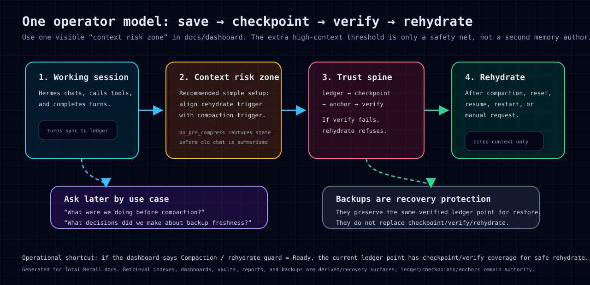

# Hermes Agent Setup

This guide installs Total Recall as a Hermes Agent memory provider named
`total-recall`. The plugin is a thin adapter over `total-recall-core`; all
authoritative continuity remains in the local ledger, checkpoints, anchors, and
incidents written by the core.

## Install a tagged release

Total Recall 1.4.0 adds capture stall reporting, recall after failed verification,
and redacted tool activity in captured turns. The supported Hermes floor is
0.23.1. Use a tagged release with managed Hermes so a dependency rebuild never
packages changes from your development checkout.

Run this from a Total Recall 1.4.0 or later CLI:

```bash
total-recall hermes release v1.4.0 --rebuild
```

The command fetches the exact tag from `dax8it/total-recall`. It puts a detached
source copy in `~/.hermes/total-recall-releases/v1.4.0` and switches the
`current` symlink to that copy. Hermes PM builds the core from that directory.
Use `--hermes-home` to set a different Hermes root, or `--source` to fetch from
a trusted local Git clone. No GitHub Release asset is required. Tags are treated
as immutable, and an earlier installed tag can be selected again the same way.

For an existing installation, preview with `--dry-run --migrate`. Add
`--link-profile NAME` for each named profile that should use the shared release.
`--migrate` keeps previous plugin paths in a `migration-*` directory beside the
releases. The release command does not modify profile settings, stores, or
ledgers. For a new profile, set `memory.provider` to `total-recall` separately
before asking PM to build its dependency.

To upgrade, run `total-recall hermes release NEW_TAG --rebuild`. Omit
`--link-profile` after the initial migration. The command does not restart any
process. `--rebuild` makes PM read the current provider selection; `hermes pm
repair` alone replays the previous dependency graph and cannot switch sources.
If PM sync fails after the pointer switches, do not restart Hermes. Fix the
sync error and repeat the command, or select the previous cached tag and
rebuild. After a successful build, check the release before restarting:

```bash
total-recall hermes doctor --hermes-python /path/to/active/venv/bin/python
```

Doctor checks the selected plugin, exact Git tag and commit, and the installed
core's origin and source bytes. It reports development checkouts, untagged
commits, and local changes. It checks the Python you pass, not the interpreter
already loaded in a running process. On a managed launcher, use
`hermes --run-module site` to identify the active environment. For a named
profile's plugin paths, pass `--hermes-home ~/.hermes/profiles/NAME` to doctor.

## Standalone and development installs

Use the following installer for a standalone copy or local development, not for
a pinned managed release. It installs the core package into Hermes' Python,
writes the plugin bundle, selects it for the profile, and checks the result:

```bash
total-recall hermes install --profile <profile> --activate --format text
hermes -p <profile> memory status
```

The installer auto-detects Hermes' Python from the `hermes` wrapper, checks
whether the Total Recall provider imports there, and runs pip in that same
environment if the provider cannot load or the version does not match. It then
writes a clean plugin bundle to:

```text
~/.hermes/plugins/memory/total-recall
~/.hermes/plugins/total-recall
```

The `plugins/memory/total-recall` path follows the public provider-plugin
layout. The flat `plugins/total-recall` path is a compatibility provider path
for Hermes v0.15.x, whose local memory loader scans `$HERMES_HOME/plugins/<name>`
for user-installed memory providers. The manifest intentionally omits a
general-plugin `kind` so Hermes auto-detects it as an exclusive memory provider
instead of loading it as a normal tool plugin.

It validates the bundle and, when `--profile <profile> --activate` is present,
runs the profile-scoped activation sequence with aligned Context Risk Zone defaults:

```bash
<hermes-python> -m pip install --upgrade <this-checkout-or-total-recall-core-version>
hermes -p <profile> config set memory.provider total-recall
hermes -p <profile> config set compression.threshold 0.55
hermes -p <profile> config set memory.total-recall.auto_rehydrate.enabled true
hermes -p <profile> config set memory.total-recall.auto_rehydrate.context_threshold 0.55
hermes -p <profile> memory status
```

Check the whole setup at any time:

```bash
total-recall hermes doctor
```

From a checkout of this repository, this single command installs the Python
package first and then writes/activates the Hermes plugin:

```bash
./scripts/install_hermes_plugin.sh --profile <profile> --activate --format text
```

## Install From Checkout Manually

Use this path only when debugging the installer or developing the plugin:

```bash
python3 -m venv .venv
. .venv/bin/activate
pip install -e .
total-recall health
total-recall hermes install --mode symlink --force --core-install always --format text
```

For Hermes installs that use a plugin directory different from
`~/.hermes/plugins`, pass `--plugin-dir /path/to/plugins`. For test or
nonstandard homes, pass `--hermes-home /path/to/hermes-home`. If auto-detection
cannot find Hermes' Python, pass `--hermes-python /path/to/hermes/venv/bin/python`.
For offline installs, pass `--core-source /path/to/total_recall_core.whl` or a
checkout path.

### Rebuild a Hermes PM checkout install

`hermes-plugin/total-recall/pyproject.toml` declares the dependency for a plugin
symlink into this checkout. Its relative path points to the repository root.
Do not copy that declaration into a standalone bundle or use it for a catalog install.

After changing the core in that checkout, run `hermes pm repair` to rebuild the
recorded environment without changing the profile's provider selection. The
core's uv cache keys include its source and packaged fixtures, so the rebuild
picks up edits even when the version has not changed. Existing Hermes processes
may still need a restart to use the new environment.

Run `total-recall hermes doctor --hermes-python /path/to/active/venv/bin/python`
if the managed launcher does not expose its virtual environment to auto-detection.
Use the active environment's interpreter, not the launcher's standalone tool
Python. Doctor returns a nonzero exit code and prints the import error if the
provider cannot load. For a non-editable install from a local checkout, it also
reports source files that differ from the installed copy. Doctor does not open
the live ledger or prove turn capture.

## Optional QMD Symlink

QMD is a derived semantic-search backend, not continuity authority. Total Recall
discovers it from `TOTAL_RECALL_QMD_BIN` or `PATH`. For portable setup, avoid
hard-coding `/usr/local/bin` because it is often root-owned on macOS. Instead:

```bash
npm install -g @tobilu/qmd   # or: bun install -g @tobilu/qmd
total-recall qmd link
qmd --version
```

`total-recall qmd link` picks the first writable PATH directory and otherwise
falls back to `~/.local/bin`; if the fallback is not on PATH, it prints the exact
PATH line to add. You can force a known user bin with:

```bash
total-recall qmd link --bin-dir ~/.local/bin
```

## Distributable Plugin Bundle

Build a clean archive for users, release assets, or plugin registry ingestion:

```bash
total-recall hermes bundle --out dist/total-recall-hermes-plugin.tar.gz
```

The archive contains:

```text
memory/total-recall/
  __init__.py
  plugin.yaml
  README.md
total-recall/
  __init__.py
  plugin.yaml
  README.md
```

The bundle is intentionally small. The provider implementation lives in the
installable `total_recall_core.hermes_provider` module, so plugin updates ship
through the Python package while Hermes sees a standard memory-provider bundle.

## Add Document Context

Use the built-in document flow when you want Hermes to remember a folder of
handoffs, policies, notes, or markdown docs without running a separate brain
system:

```bash
total-recall documents ingest ./docs ./handoff.md
total-recall knowledge query --query "What context did we import?" --format text
total-recall checkpoint --session-id documents --label document-import
```

The document flow writes normal ledger events, so imported context participates
in search, Knowledge Engine queries, backup/export, checkpoints, and verified
rehydration. See [document ingest](document-ingest.md) for supported formats,
limits, and dry-run examples.

Use source ingest for working-context events like meetings, email, Slack,
GitHub, CRM, tickets, calendars, and agent transcripts:

```bash
total-recall sources ingest \
  --type meeting \
  --title "Renewal Review" \
  --occurred-at 2026-01-05T12:00:00Z \
  --text "Decision: Renewal policy is month-to-month."
```

Hermes can also call the `total_recall_source_ingest` tool directly when it has
source text worth preserving.

## Export An Obsidian Vault

When you want a human-readable graph over Hermes continuity, export a local
Obsidian-compatible vault:

```bash
total-recall vault export --out ~/TotalRecallVault
```

The vault includes `Sources/`, `Entities/`, `Documents/`, `Timeline/`,
`Decisions/`, `Promises/`, and `Tasks/` notes with Obsidian wikilinks. It is a
derived projection: Total Recall's ledger, checkpoints, and anchors remain the
authority. Edited vault notes become memory only through
`total-recall vault import-preview` and `total-recall vault import-promote`.
See [Obsidian vault export](obsidian-vault-export.md).

## Smoke Profile

Test on a non-live profile before switching an active agent:

```bash
hermes profile create total-recall-smoke || true
hermes -p total-recall-smoke config set memory.provider total-recall
hermes -p total-recall-smoke memory status
```

Then run a core cycle against the same store:

```bash
total-recall health
total-recall ingest --kind note --text "Total Recall Hermes smoke memory." --session-id smoke
total-recall search "Hermes smoke memory"
total-recall checkpoint --session-id smoke
total-recall verify --session-id smoke
total-recall learning review --session-id smoke --no-persist --format text
total-recall rehydrate --session-id smoke --query "Hermes smoke memory"
total-recall doctor
```

Only switch a live profile after health, search, checkpoint, verify, rehydrate,
doctor, and the Hermes memory status check pass.

## Select Provider

```bash
total-recall hermes install --profile <profile> --activate
```

Manual equivalent:

```bash
hermes -p <profile> config set memory.provider total-recall
hermes -p <profile> memory status
```

If you have agent aliases, run the equivalent config command through each alias
after confirming the alias targets the intended Hermes profile.

## Provider Hooks

The plugin implements the Hermes memory-provider lifecycle:

- `prefetch`
- `queue_prefetch`
- `sync_turn`
- `on_session_end`
- `on_session_switch`
- `on_pre_compress`
- `get_tool_schemas`
- `handle_tool_call`

Provider tools:

- `total_recall_search`
- `total_recall_status`
- `total_recall_checkpoint`
- `total_recall_verify`
- `total_recall_trust_verify`
- `total_recall_learning_review`
- `total_recall_rehydrate`
- `total_recall_incidents`
- `total_recall_source_ingest`
- `total_recall_knowledge_query`
- `total_recall_knowledge_freshness`
- `total_recall_knowledge_status`
- `total_recall_knowledge_synthesis_status`
- `total_recall_knowledge_compiled_truth`
- `total_recall_knowledge_graph_inspect`
- `total_recall_knowledge_graph_timeline`
- `total_recall_federation_query`

`total_recall_learning_review` produces the overnight candidate-card preview. It
returns layer routing, action boundaries, promotion decisions, and a wake-up diff
without mutating the ledger.

`total_recall_federation_query` requires explicit `authorize=true` and returns
workspace-separated results. It does not silently merge another agent's memory
into the current profile.

## Automatic Rehydration

Hermes owns compaction thresholds. Total Recall owns whether memory is safe to
reuse after context changes. For humans, manage both with one visible concept:

```text
Context Risk Zone = start saving/checkpointing/verifying before old chat is lost
```

Recommended simple profile policy:

```yaml
compression:
  enabled: true
  threshold: 0.55

memory:
  provider: total-recall
  total-recall:
    auto_rehydrate:
      enabled: true
      context_threshold: 0.55
```

That alignment makes the operator story simple: when Hermes gets close enough to
compact, Total Recall is also allowed to prepare verified rehydrate context. A
higher `auto_rehydrate.context_threshold` is just an emergency/high-context
safety net; compaction hooks still fire at Hermes' own threshold.



On substantive turns, Total Recall ranks the current query with SQLite FTS5.
At session start it also loads that session's saved resume packet when one is
available, leaving room for both decisions and query hits. Hermes skips
prefetch for trivial prompts such as bare greetings.

The automatic index keeps a checked byte position. Normal appends add only the
suffix, often in the background between turns; changing the query never starts
a ledger scan. Automatic `PASS` covers only excerpts in the selected signed
ledger prefix, not the reduced state. Newer turns compete for the same space
and are individually marked `UNVERIFIED`. The resume packet is derived and is
also marked `UNVERIFIED`; use explicit `rehydrate` in `resume` mode for full
verification. Only allowed scopes are eligible for ledger excerpts. Turning
`auto_rehydrate.enabled` off restricts prefetch to unverified current-session
excerpts and skips the packet.

On upgrade, a large store builds the disposable automatic index once, in the
background. While it catches up, an existing SQLite index and saved packet can
still supply `UNVERIFIED` context. A restored or externally edited ledger also
requires a fresh check; size growth on its own is not proof of an append. The
provider does not rewrite existing ledgers, checkpoints, or anchors to migrate.

Total Recall allows up to 5.5 seconds for prefetch, inside Hermes' eight-second
deadline. If there is no usable context while the cache catches up, or the
budget expires, the affected reply has a `Total Recall automatic recall did not
finish in time` footer. That does not mean capture stopped. Explicit verify,
rehydrate, and recall tools retain their full checks and search paths. See
[index maintenance](operational-manual.md#index-maintenance) for the distinction.

### What Gets Saved, When

- `sync_turn()` saves both redacted text strings in full. On Hermes versions
  that supply redacted `messages`, it also saves the current turn's tool calls
  and results. It does not copy calls from earlier turns in the same transcript.
- Each call records its name, arguments, and call ID. Each result records a
  UTF-8 excerpt of up to 96 bytes, the full byte count and SHA-256 of the
  redacted content, and the message reference Hermes supplied. Total Recall
  does not fetch transcript text from `state.db`.
- Tool activity is an ordered list of calls and results. Starting at 1,024
  JSON bytes, Total Recall stores the whole list losslessly as bzip2 and base64
  if that makes the ledger line smaller. It does not cap the number of calls
  or truncate arguments. See [turn records](operational-manual.md#read-a-captured-turn)
  for the format and lookup rules.
- A failed recall check does not disable capture. If a malformed ledger prevents
  an append from even starting, the provider queues the turn in
  `state/pending_events.jsonl` rather than writing through the damaged record.
  Pending turns are not ledger captures; the watchdog continues to see a stall.
- Before compaction, Hermes calls `on_pre_compress(messages)`. Total Recall uses
  the recent text to find context for the compactor, but writes only a marker
  and message count.
- Session switches/resets/resumes are written as session lifecycle events.
- Session end writes a marker and message count, then creates a checkpoint.
  Neither boundary stores another transcript excerpt. Earlier events stay
  unchanged and verify in the same chain as new events.
- Manual `total_recall_checkpoint` / `total-recall checkpoint` creates a fresh
  checkpoint when a handoff or risky operation needs a hard boundary.

### Capture watchdog on macOS

The outside watchdog works even when Hermes cannot import Total Recall. It
compares completed reply timestamps in each selected profile's local `state.db`
with the last `hermes.sync_turn` record in that profile's ledger. An alert is due
when a reply has gone 12 hours without further capture progress. Non-turn ledger
events do not reset the clock. The first finished reply after the provider loads
during such a gap adds a `Total Recall capture gap` footer with the UTC dates,
before the new reply is captured. The footer is not a backfill or proof of recovery.

Use a stable Python 3.11+ with PyYAML installed. Run without `--enable-macos`
for a read-only preview. To install a new LaunchAgent, run this as the logged-in
Mac user after selecting a release:

```bash
python3 -B ~/.hermes/total-recall-releases/current/scripts/hermes_capture_watch.py --enable-macos
```

Keep the `current` path and the Python executable in place. The LaunchAgent
follows later release switches at the next check. If the agent already exists,
use the [migration commands](operational-manual.md#capture-stall-watch) instead.
The LaunchAgent checks immediately and hourly, independently of Hermes or its
gateway. `Total Recall capture stalled`
appears in macOS Notification Center for that login, with the profile and dates
but no conversation text. See the [operator runbook](operational-manual.md#capture-stall-watch)
for scope, diagnostics, and how to stop the watch.

### Search And Rehydrate Use Cases

```bash
# What were we doing before compaction?
total-recall rehydrate --session-id main --query "active work before compaction"

# Find the session/context where a dashboard panel was discussed.
total-recall search "Total Recall dashboard backup panel"

# Ask for a cited answer instead of raw hits.
total-recall knowledge query --query "What was the last verified state before rehydrate?" --format text
total-recall knowledge query --query "What decisions did we make about backup freshness?" --format text
```

Use `search` for raw cited hits, `knowledge query` for synthesized cited answers,
and `rehydrate` when Hermes needs a compact context block after compaction,
reset, resume, or restart.

## Backup And Recovery

Create a portable backup:

```bash
total-recall export --out total-recall-backup.tar.gz
```

The export includes authoritative ledger, state, checkpoints, anchors, reports,
incidents, external-memory queues, and local signing keys. Treat the bundle as
private agent memory.

Restore into an empty store:

```bash
TOTAL_RECALL_HOME=/path/to/new/store total-recall import total-recall-backup.tar.gz
TOTAL_RECALL_HOME=/path/to/new/store total-recall verify
TOTAL_RECALL_HOME=/path/to/new/store total-recall doctor
```

Use `--replace` only when intentionally replacing the target store:

```bash
TOTAL_RECALL_HOME=/path/to/store total-recall import total-recall-backup.tar.gz --replace
```

`import` verifies the bundle manifest and rejects unsafe tar paths before
copying files. `verify` refreshes SQLite/FTS from the chain-checked ledger;
LanceDB and QMD rebuilds require explicit maintenance.

For a managed local dashboard and retention policy:

```bash
TOTAL_RECALL_HOME=/path/to/profile/total-recall \
  total-recall dashboard --backup-dir ~/total-recall-backups --keep 14 --keep-days 90
```

See `docs/backup-dashboard.md` for launchd automation and private remote-backup
notes.

## Troubleshooting

Run:

```bash
total-recall doctor
hermes -p <profile> memory status
total-recall verify
total-recall trust verify
```

Common states:

- `anchor_not_found`: create a new checkpoint only after confirming the ledger
  and checkpoint history are expected.
- `anchor_signature_mismatch`: treat the store as tampered until investigated.
- `ledger_or_state_invalid`: do not rehydrate; inspect the ledger and restore
  from a known-good export if needed.
- `index_not_found` or stale SQLite/FTS index: run
  `total-recall index rebuild --backend sqlite-fts`.
- Stale LanceDB or QMD index: recall skips it and can still use local results.
  Run `total-recall index rebuild --backend lancedb` or `--backend qmd` when
  external maintenance is wanted; it is not required to repair a signature.

For missing original session records in an otherwise valid store, see the
[operator-controlled session recovery utility](operational-manual.md#recover-missing-hermes-session-records).
